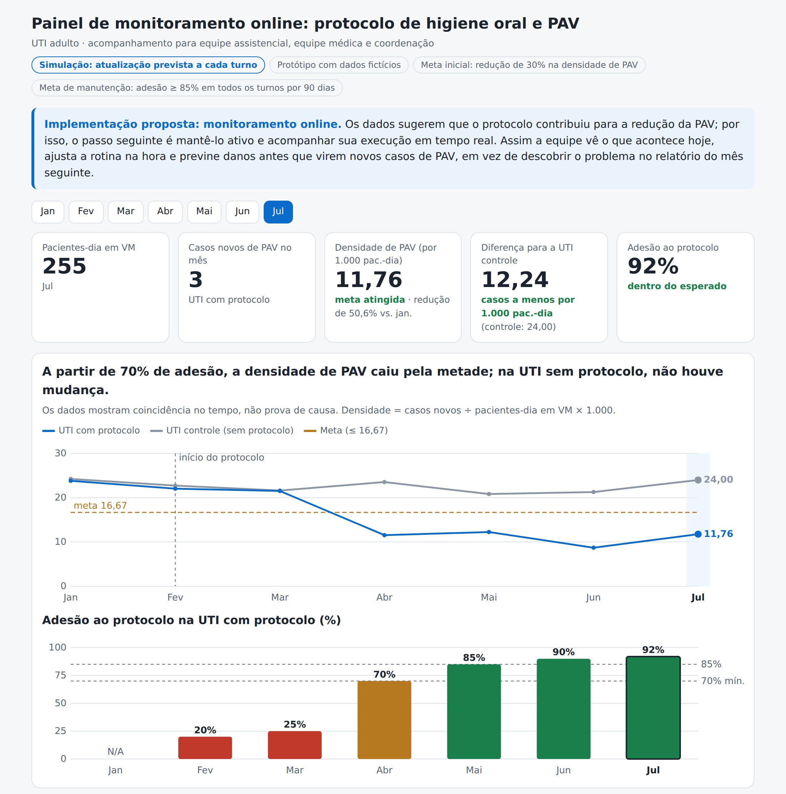
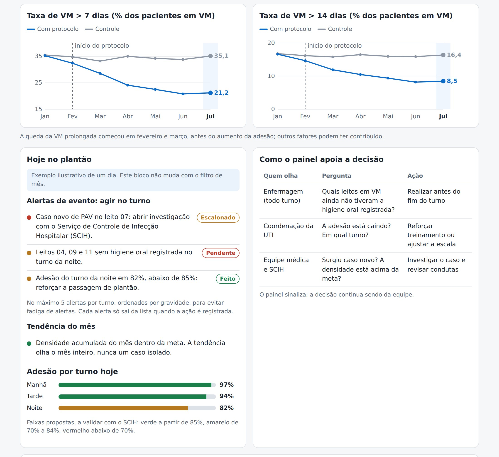
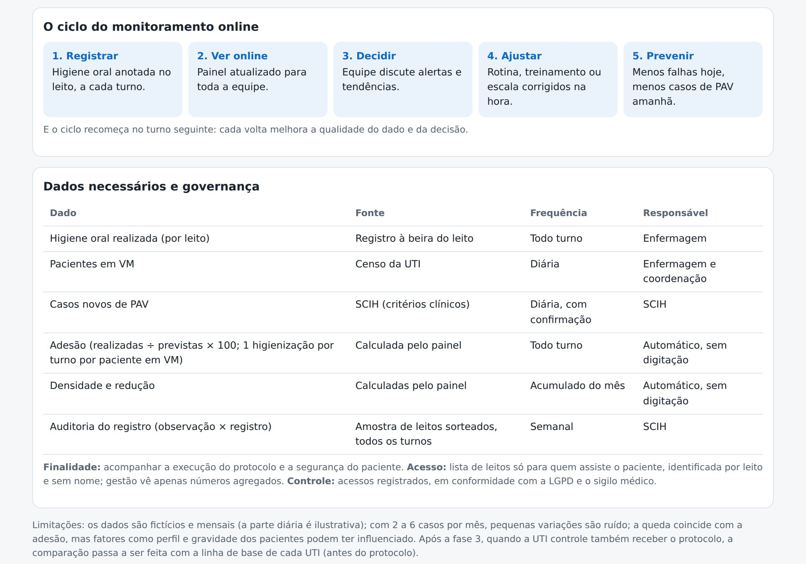

# Higiene oral e pneumonia associada à ventilação (PAV) na UTI

**Análise de dados e proposta de monitoramento por turno, com painel interativo**

> ⚠️ **Caso fictício.** Projeto acadêmico em grupo, desenvolvido na Pós-graduação em Análise de Dados e Inteligência Artificial da CESAR School. Os dados foram criados para a atividade e não representam pacientes ou hospitais reais.

🔗 **[Abrir o painel interativo](https://AersonZamboni.github.io/pav-uti-monitoramento/)**

---

## O problema

A pneumonia associada à ventilação mecânica (PAV) é uma das infecções mais comuns em UTI. Ela agrava o quadro do paciente, prolonga a internação e aumenta os custos do hospital. Um protocolo de higiene oral foi implantado em uma UTI adulto em fevereiro de 2026, e a pergunta era: **ele está funcionando, e como garantir que continue funcionando?**

## A pergunta (SMART)

Qual a variação da densidade de incidência de PAV após o início do protocolo, de janeiro (antes da intervenção) a julho de 2026, tendo como meta uma redução de pelo menos 30%?

## Os dados

- **Duas UTIs do mesmo hospital:** uma com o protocolo (intervenção) e uma sem (controle).
- **7 meses:** janeiro como mês de referência e fevereiro a julho como período de acompanhamento.
- **Indicadores:**
  - **Densidade de PAV:** casos novos ÷ pacientes-dia em ventilação mecânica × 1.000.
  - **Taxa de adesão ao protocolo:** higienizações realizadas ÷ previstas × 100, com uma higienização prevista por turno para cada paciente em ventilação.
  - **Percentual de pacientes em ventilação por mais de 7 e de 14 dias.**

## Principais achados

| Indicador (UTI com protocolo) | Janeiro | Julho |
|---|---|---|
| Densidade de PAV (por 1.000 pacientes-dia) | 23,81 | 11,76 (−50,6%) |
| Adesão ao protocolo | — | 92% |
| Ventilação > 7 dias | 35,24% | 21,20% |

1. **A queda só veio a partir de 70% de adesão.** Em fevereiro e março, com adesão de 20% a 25%, a densidade de PAV praticamente não mudou.
2. **A UTI controle não mudou:** variou entre 20,83 e 24,24 no período todo. Isso reforça a hipótese de que o protocolo contribuiu para a queda, embora não a comprove.
3. **Nem toda melhora pode ser atribuída ao protocolo.** A ventilação prolongada começou a cair antes do aumento da adesão, o que sugere a influência de outros fatores.

## A proposta: monitoramento por turno

O resultado depende da adesão **diária**, mas a equipe só via os dados no relatório do mês seguinte. A proposta é consolidar automaticamente o registro que já existe e mostrá-lo em um painel atualizado a cada turno, com:

- **Alertas de evento**, por exemplo leito sem registro no turno ou caso novo de PAV, com a situação de cada um (pendente, escalonado, feito) e um limite de alertas por turno;
- **Tendência do mês**, separada dos eventos, para não reagir a um caso isolado;
- **Auditoria semanal por amostragem**, porque quem registra é quem executa;
- **Meta de manutenção:** adesão de pelo menos 85% em todos os turnos por 90 dias;
- **Plano em três fases**, com prazos, responsáveis e recursos.

**Ganho estimado:** comparando abril a julho com a média de janeiro a março, cerca de **11 casos de PAV a menos em 4 meses**. Usando parâmetros da literatura (Rosenthal et al., 2011; Nangino et al., 2012), isso equivale a cerca de **22 dias de leito de UTI liberados** e a uma economia da ordem de **R$ 13 mil** (faixa de R$ 7 mil a R$ 27 mil). É uma estimativa sobre dados fictícios.

## O painel

| Indicadores e tendência | Alertas e decisão | Ciclo e governança |
|---|---|---|
|  |  |  |

No painel, você escolhe o mês e vê os indicadores mudarem; os alertas e a adesão por turno são um exemplo ilustrativo de um dia.

## Limitações

- Dados fictícios e mensais; com 2 a 6 casos por mês, pequenas variações são ruído.
- A queda coincide com a adesão, mas coincidência no tempo não prova causa.
- Assumimos que as duas UTIs têm perfil clínico semelhante, sem dados de idade ou gravidade para confirmar.
- A meta inicial foi calculada a partir de um único mês de referência.

## O que mudou depois do feedback

A primeira versão foi avaliada pelo professor, e a revisão trouxe aprendizados importantes:

- **De "comprovado" para "hipótese":** o texto tratava o protocolo como eficaz. Reescrevemos as conclusões para refletir o que os dados realmente permitem afirmar.
- **Definição dos indicadores:** a adesão, número central do trabalho, não tinha numerador e denominador definidos. Também deixamos claro o que mede o indicador de ventilação prolongada.
- **Base de comparação mais robusta:** o ganho estimado usava um único mês como referência; passamos a usar a média de três meses.
- **Proposta mais concreta:** meta de manutenção, cronograma, responsáveis, auditoria do dado e um plano para quando a UTI controle deixar de existir.
- **Painel mais legível e honesto:** fontes maiores no celular, alertas com situação, separação entre evento e tendência, e aviso de que a atualização é simulada.

## Minha participação

Fui responsável por três frentes do projeto:

- **Storytelling:** construí a narrativa que conecta os dados à decisão. Ela parte do impacto da PAV para o paciente e para a equipe, apresenta os resultados e termina com a descoberta que originou a proposta: a queda só apareceu a partir de 70% de adesão, então manter o protocolo depende de acompanhar sua execução todos os dias.
- **Dashboard:** defini, junto com o grupo, o que o painel precisava responder para cada perfil (enfermagem, coordenação, equipe médica e controle de infecção) e conduzi o desenvolvimento do protótipo interativo, construído com apoio de IA (Claude).
- **Revisão após o feedback:** analisei cada ponto da avaliação do professor e conduzi as correções no relatório e no painel. Calibrei as conclusões para tratar o protocolo como hipótese, defini os indicadores (adesão e ventilação prolongada), refiz a estimativa de ganhos com uma base de comparação mais robusta e com parâmetros da literatura, e completei a proposta com meta de manutenção, cronograma, responsáveis e auditoria do dado.

## Ferramentas

- Word / Google Docs: relatório da análise.
- HTML, CSS e JavaScript: protótipo do painel, **construído com apoio de IA (Claude)** a partir das decisões do grupo.
- IA generativa: apoio na redação, revisão e conferência de cálculos. Todo o conteúdo foi revisado e validado pelo grupo.

## Próximos passos

- Refazer o painel em Power BI ou Looker Studio.
- Incluir um gráfico de controle para acompanhar a tendência com poucos casos.

## Equipe (Grupo 1)

Aerson Zamboni Maia Júnior, Arabella Granjeiro dos Santos, Giovanna Tarquinio Sales Muniz, Jamila-Maria de Souza Abid e Natália Kuniscki de Albuquerque Andrade.

## Referências

- DIAS, L. F.; SOUSA, D. A. O impacto de protocolos e bundles de baixo custo na mortalidade, tempo de internação e uso de recursos em unidades de terapia intensiva: uma revisão guarda-chuva. *Revista ft*, v. 30, n. 155, 2026.
- NANGINO, G. O. et al. Impacto financeiro das infecções nosocomiais em unidades de terapia intensiva em hospital filantrópico de Minas Gerais. *Revista Brasileira de Terapia Intensiva*, v. 24, n. 4, p. 357-361, 2012.
- ROSENTHAL, V. D. et al. Time-dependent analysis of extra length of stay and mortality due to ventilator-associated pneumonia in intensive-care units of ten limited-resources countries. *Epidemiology and Infection*, v. 139, n. 11, p. 1757-1763, 2011.
